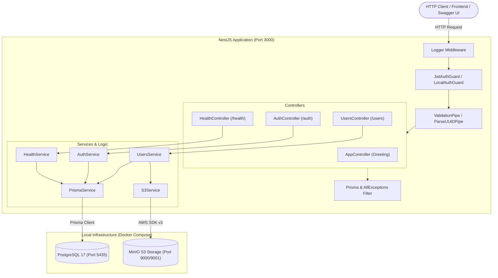

# User Management System API

[](https://nestjs.com/)
[](https://www.typescriptlang.org/)
[](https://www.postgresql.org/)
[](https://www.prisma.io/)
[](https://swagger.io/)
[](https://vitest.dev/)
[](https://oxc.rs/)

A REST API backend under active development, built with **NestJS 12**, **PostgreSQL 17**, and **Prisma 7**. It includes access/refresh-token authentication, scoped permission checks, validated JPEG avatar uploads, PostgreSQL health probes, development Swagger documentation, and local Docker Compose infrastructure. Authorization and production deployment work remain incomplete.

---

## Project Status and Remaining Work

This repository is an API backend; it does not include a frontend. The local
Compose setup is not a production deployment configuration.

- **Authorization:** platform permission checks and organization guard infrastructure
  exist, but organization endpoints, role assignment validation, ownership transfer,
  remain unfinished; deletion auditing is intentionally deferred. Account deletion protects owners of
  undeleted organizations and the SUPER_ADMIN account (including self-deletion). Current
  deletion concurrency was verified against local PostgreSQL; future role/ownership
  mutation flows still need coordinated safeguards and verification.
- **Sessions:** logout and password changes revoke refresh sessions. Existing access
  JWTs may remain usable until expiry (15 minutes by default), except deleted users
  are rejected by the JWT strategy. Immediate access-token revocation, browser cookie
  transport, and session-retention work are deferred.
- **Deployment:** CORS is deferred until browser client origins are known. Shared
  throttling storage, centralized logging, and routing/drain timing require deployment
  work. Readiness checks PostgreSQL and shutdown state, not MinIO.
- **Storage:** replaced-avatar cleanup is durable and retryable. Current avatars of
  soft-deleted users remain stored and publicly readable under the current policy.
  Fresh-machine MinIO image provisioning remains unresolved as documented below.
- **Verification:** build/lint and targeted/manual checks are not a comprehensive
  security, concurrency, or deployment test suite. Verify each deferred behavior
  before relying on it in production.

---

## 🌟 Key Features

- **Authentication & Security**:
  - Passport Local strategy for credential verification and secure bcrypt password hashing.
  - Short-lived access JWTs and database-backed refresh-token rotation with family revocation.
  - Global JWT authentication, request throttling, password change, and logout/logout-all.
  - Type-safe `@CurrentUser()` custom decorator for extracting authenticated identity.
- **User Management (CRUD)**:
  - Public registration, permission-protected account listing, self-service profile updates, and soft deletion.
  - Account deletion allows self-service or platform USER delete permission; owners of undeleted organizations are protected. Last-admin protection remains pending.
  - Robust request validation powered by `class-validator` and `ParseUUIDPipe`.
- **S3-Compatible Avatar Storage**:
  - Single-part image uploads via Multer interceptor.
  - JPEG signature filtering followed by decoding and re-encoding with Sharp; input is limited to 16 million pixels. EXIF orientation is applied, images are resized to fit within 1024 × 1024 pixels while preserving aspect ratio without enlarging smaller images, and metadata is stripped. The upload accepts one file and no text fields. Both the input and processed JPEG are limited to 2 MB (2,097,152 bytes); oversized output is rejected with HTTP 413. The stored JPEG may differ in size and quality.
  - Storage integration with AWS S3 / MinIO via `@aws-sdk/client-s3` and public URL resolution.
- **Application Architecture**:
  - Clean separation: `common/` (cross-cutting), `core/` (infrastructure), and `modules/` (domain logic).
  - Global Prisma exception filter mapping database constraints to standard HTTP status codes.
  - Request logging middleware and a shared response envelope. Centralized log collection is deferred.
- **Auto-Generated Documentation**:
  - Interactive OpenAPI/Swagger UI at `/api-docs` in development only, with JWT Bearer authorization support.
- **Modern Developer Tooling**:
  - Native Node.js ES Modules (`"type": "module"`).
  - Ultra-fast static analysis via **Oxlint** and unit testing via **Vitest**.

---

## 🏗️ System Architecture



---

## 🛠️ Tech Stack

| Layer                  | Technology                                                       | Description                                |
| :--------------------- | :--------------------------------------------------------------- | :----------------------------------------- |
| **Backend Framework**  | [NestJS 12](https://nestjs.com/)                                 | Progressive Node.js framework (ESM)        |
| **Language**           | [TypeScript 6](https://www.typescriptlang.org/)                  | Strongly-typed JavaScript                  |
| **Database**           | [PostgreSQL 17](https://www.postgresql.org/)                     | Relational database engine                 |
| **ORM**                | [Prisma 7](https://www.prisma.io/)                               | Next-generation Node.js ORM                |
| **Object Storage**     | [MinIO](https://min.io/) / [AWS S3](https://aws.amazon.com/s3/)  | S3-compatible cloud object storage         |
| **Authentication**     | [Passport](https://www.passportjs.org/) + [JWT](https://jwt.io/) | Access JWTs and stored refresh sessions                 |
| **API Documentation**  | [Swagger / OpenAPI 3.0](https://swagger.io/)                     | Auto-generated interactive API docs        |
| **Testing**            | [Vitest](https://vitest.dev/)                                    | Vite-powered unit test runner              |
| **Linter & Formatter** | [Oxlint](https://oxc.rs/) + [Prettier](https://prettier.io/)     | High-performance linter and code formatter |
| **Containers**         | [Docker Compose](https://www.docker.com/)                        | Local containerized services               |

---

## 🚀 Getting Started

### Prerequisites

- **Node.js**: compatible with the installed Prisma requirement: `^20.19 || ^22.12 || >=24.0`
- **npm**: `v10.x` or higher
- **Docker & Docker Compose**: Installed and running

### 1. Clone & Install Dependencies

```bash
git clone <repository-url>
cd user-management-system
npm install
```

### 2. Environment Configuration

Copy the example environment configuration file:

```bash
cp .env.example .env
```

Configure `.env` with your environment values. The database and storage values
below are for local development; JWT secrets must be generated separately:

```ini
PORT=3000

# PostgreSQL
POSTGRES_USER=
POSTGRES_PASSWORD=
POSTGRES_DB=user_management_system
DATABASE_URL=

# JWT
JWT_ACCESS_TOKEN_SECRET=
JWT_REFRESH_TOKEN_SECRET=
JWT_ACCESS_TOKEN_EXPIRES_IN=900
JWT_REFRESH_TOKEN_EXPIRES_IN=604800

# MinIO / S3
S3_ENDPOINT=http://localhost:9000
S3_REGION=us-east-1
S3_BUCKET=avatars
S3_ACCESS_KEY=
S3_SECRET_KEY=
S3_FORCE_PATH_STYLE=true
S3_PUBLIC_URL=http://localhost:9000
```

`S3_PUBLIC_URL` is the public storage origin, without the bucket name.
`S3Service.getPublicUrl()` appends `S3_BUCKET` and the stored object key.
For example, bucket `avatars` and key `example.jpg` produce
`http://localhost:9000/avatars/example.jpg`. New avatar keys contain only the
filename; existing keys with an `avatars/` prefix must remain unchanged unless
the corresponding objects are also moved.

`LOG_DATABASE_QUERIES` defaults to `false` when omitted. Setting it to `true`
enables SQL DEBUG logs only when `NODE_ENV=development`. SQL text may contain
sensitive literals; enable it only temporarily with suitable development data.
Slow-query warnings remain enabled in every environment.

Fill the empty database and storage fields with your configured credentials.
Generate each JWT secret separately using this command (run it twice):

```bash
node --input-type=module -e "import { randomBytes } from 'node:crypto'; console.log(randomBytes(32).toString('hex'));"
```

Put the two results into `JWT_ACCESS_TOKEN_SECRET` and `JWT_REFRESH_TOKEN_SECRET`
in your private `.env` or deployment secret store. Each secret must have at least
64 characters, contain no whitespace, and differ from the other secret. Length
alone does not establish randomness. Never commit or share real secrets, and use
different secrets for development and production. Replace any exposed secret;
changing a signing secret invalidates tokens signed with its previous value.

### 3. Start Database & Storage (Docker)

Start the local PostgreSQL and MinIO instances in the background:

`docker-compose.yml` is for local development. Published PostgreSQL and MinIO
ports bind to `127.0.0.1`, so they are accessible from this machine. Containers
communicate through their Compose service names on the internal Docker network.
Production deployment requires its own networking, secret management, and
service access configuration.

Compose reads `POSTGRES_USER`, `POSTGRES_PASSWORD`, `POSTGRES_DB`,
`S3_ACCESS_KEY`, and `S3_SECRET_KEY` from the private `.env` or shell environment.
Missing or empty values stop setup. Keep `DATABASE_URL` consistent with the
actual PostgreSQL credentials; URL-encode special characters in its credentials.
For this local setup, the S3 credentials also configure MinIO's root account and
are shared with the initializer. Production should use a restricted application
account instead of root credentials.

For an existing PostgreSQL volume, keep the credentials of the existing database.
Changing the Compose environment does not update an existing database role's
password or recreate users/databases. Credential rotation requires changing the
role inside PostgreSQL and updating the application's connection configuration.
Do not delete the volume to rotate credentials.

```bash
docker compose up -d
```

- **PostgreSQL**: `localhost:5435`
- **MinIO S3 API**: `localhost:9000`
- **MinIO Web Console**: `http://localhost:9001` (use your configured credentials)

The `minio-init` service reuses the MinIO image's bundled `mc` client. It retries
connection/authentication, creates the `avatars` bucket if missing, and applies
`docker/minio/avatars-policy.json`. Existing objects are preserved, but the
bucket policy is replaced with the policy in that file. The initializer reuses
MinIO's credentials through a YAML anchor; the application's S3 credentials must
also permit uploads and deletes in this bucket.

Check initialization before uploading avatars:

```bash
docker compose logs minio-init
docker compose ps -a minio-init
```

Expect `Avatar bucket initialization completed.` and exit code `0`. An exited
initializer is normal. To rerun setup explicitly:

```bash
docker compose run --rm minio-init
```

The policy allows anonymous object downloads and bucket-location reads. It does
not grant anonymous uploads, deletes, or object listing. Anyone who can reach
an avatar's plain URL can view or download it without application login.

**Local image requirement:** `minio-init` uses `pull_policy: never`, so
`quay.io/minio/minio:RELEASE.2025-04-22T22-12-26Z` must already exist in the local
Docker image cache. This workaround was verified locally after registry pulls
failed. Image provisioning for a fresh machine remains unresolved; this setup
does not guarantee a successful first-time installation without that image.
Do not delete the bucket or Docker volumes to rerun initialization: deleting
objects leaves existing database avatar keys pointing to missing files.

### 4. Run Database Migrations

Apply the checked-in migrations and generate the Prisma client:

```bash
npx prisma migrate deploy --config prisma7.config.ts
npx prisma generate --config prisma7.config.ts
```

When developing a schema change, generate a migration with
`npx prisma migrate dev --create-only --config prisma7.config.ts` and review its
SQL before applying it. Adding the required organization `owner_id` to a
populated table needs a backfill with the actual owners before enforcing NOT NULL.

### 5. Bootstrap the System Admin

Add these fields to your private `.env` and supply your admin account details:

```ini
SEED_ADMIN_EMAIL=
SEED_ADMIN_USERNAME=
SEED_ADMIN_PASSWORD=
SEED_ADMIN_FIRST_NAME=
SEED_ADMIN_LAST_NAME=
SEED_ADMIN_BIRTH_DATE=
```

Use a valid email, a unique username, nonempty names, and an ISO birth date
(`YYYY-MM-DD`) that is not in the future. The password must contain at least
15 characters, include a non-whitespace character, and fit within 72 UTF-8 bytes.
Never commit real bootstrap credentials or put them in `.env.example`.

After migrations and client generation, run:

```bash
npm run prisma:seed
```

The command runs `prisma/seed.ts` through `tsx`, using the PostgreSQL adapter.
It creates the `USER:read`, `USER:delete`, and `ORGANIZATION:delete` permissions,
the global `SUPER_ADMIN` role (`isSystem = true`, `organizationId = null`), their
permission links, and the admin's `UserPlatformRole` assignment in one transaction.
The password is stored as a bcrypt hash. No system organization is created.

Repeat runs preserve the existing admin's password and profile and repair the
seeded role and permission records. Bootstrap refuses to promote an ordinary
account with the configured email, restore a revoked admin assignment, or reuse
a soft-deleted admin account. Changing the seed password does not reset the
existing account's password. All bootstrap fields are still required on reruns.
Bootstrap refuses to create a second active SUPER_ADMIN for a different email.
This is a bootstrap policy, not a database uniqueness constraint on role holders;
future assignment APIs must enforce the same single-holder rule and protect the
reserved role from unauthorized mutation. Run the seed explicitly; it does not run at application startup.

The admin logs in through `POST /auth/login` normally. `GET /users` requires
the platform permission `USER:read`; authenticated users without it receive
HTTP 403. The global `PermissionsGuard` runs after authentication and
throttling and checks active assignments, system roles, permission links, and
permissions in the database on each request. Organization roles do not grant
platform permissions. Other platform operations and organization service flows
remain to be implemented; bootstrap records alone do not protect a route.

Platform permission queries are shared through `PermissionsService`, which the
guard uses and domain policies can call for checks such as self-or-permission.
`GET /users/:id` delegates to `UsersService.findOneForActor`: an active user may
read their own account, or another account with active platform `USER:read`.
Even SUPER_ADMIN needs that permission for cross-account access. The service
checks actor state and permission before target lookup in one transaction:
inactive/missing actor is 401, unauthorized cross-account access is 403 regardless
of target existence, and an authorized missing/deleted target is 404. Responses
omit the password hash and replace the stored avatar key with its public URL.

It exposes single-permission and all-permissions checks. `DELETE /users/:id`
passes actor/target IDs to the shared deletion service. It verifies the active
actor and permits self-deletion or platform `USER:delete` within the same
serializable transaction as deletion and refresh-token revocation. Both paths
return HTTP 409 for owners of undeleted organizations (including inactive ones)
and any target holding an active global system SUPER_ADMIN assignment, regardless
of who calls. Other platform admins are not protected by an admin-count rule;
USER:delete and ownership checks still apply. Missing targets return
404; authorized repeat deletion is a no-op returning 204. Inactive actors receive
401, and unauthorized cross-account deletion receives 403 before target lookup.
Memberships, role assignments, and the current avatar are retained; JWT
authentication rejects deleted users. Audit recording is intentionally deferred.
See [USER_DELETION_VERIFICATION.md](USER_DELETION_VERIFICATION.md) for the real
database scenarios, retry fix, and verification limits. The
remaining authorization work is summarized in Project Status and Remaining Work.

Organization ownership is stored separately in `Organization.ownerId`.
Platform roles use `UserPlatformRole`; organization roles use `MemberRole`.
The same `PermissionsGuard` handles organization scope for future routes marked
with `@RequireOrganizationPermissions({ resource: 'MEMBER', action: 'invite' })`.
Such routes must include a UUID `:organizationId` parameter. The guard requires
an active membership, an active organization, and all listed permissions from
active roles in that organization. System administrators have no automatic bypass. If both scope decorators are present, both requirements must pass.
The actual owner has full organization permission authority after the active
membership and organization checks. `ownerId` is the sole source of ownership;
an `OWNER` role assignment does not confer ownership or supply permissions to
other members. No OWNER role is needed. Business rules and platform permissions
still apply independently.
Organization endpoints, initial ADMIN/MEMBER role provisioning, assignment
validation, and safe ownership-transfer rules are still to be implemented.

### 6. Start the Application

```bash
# Development mode with watch:
npm run start:dev

# Production build & run:
npm run build
npm run start:prod
```

The bootstrap enables Nest shutdown hooks so supported termination signals invoke
the application's lifecycle cleanup. Forced termination cannot run cleanup hooks.
Verify Ctrl+C (SIGINT) on Windows and SIGTERM separately in the Linux deployment;
enabling hooks alone does not verify in-flight request or worker shutdown behavior.

Once started, the server will log:

```text
[Nest] ... LOG [Bootstrap] Application is running on: http://localhost:3000
[Nest] ... LOG [Bootstrap] Swagger documentation: http://localhost:3000/api-docs
```

---

## 📖 API Documentation

Interactive Swagger documentation is available when `NODE_ENV=development` at:

👉 **[http://localhost:3000/api-docs](http://localhost:3000/api-docs)**

Raw OpenAPI JSON specification: `http://localhost:3000/api-docs-json`

Swagger UI and raw OpenAPI endpoints (JSON/YAML) are not registered in production
or test environments. Document generation and the Swagger startup log are also
skipped. Configuration defaults `NODE_ENV` to development when omitted, so set
`NODE_ENV=production` explicitly in production; the `start:prod` script does not
set it for you. This policy does not replace authentication or authorization on
business endpoints. The startup log example above includes Swagger only in development.

### Liveness

`GET /health/live` is public and returns HTTP 200 with `data.status = "ok"`
inside the standard response envelope. It checks whether the application can
respond, without querying PostgreSQL or MinIO. Health probes skip the named
rate-limit policies so repeated probes do not trigger HTTP 429.

```powershell
curl.exe -i http://localhost:3000/health/live
```

Use your configured application port if it differs from 3000. This endpoint is
not readiness: dependency availability and shutdown readiness are not checked by liveness.
The `/` route remains an application greeting, not a dependency health check.

### PostgreSQL Readiness

`GET /health/ready` is public and skips the same throttling policies. It performs
a read-only Prisma query against the users table; an empty table is healthy.
Success returns HTTP 200 with `data.status = "ok"` and
`data.checks.database = "up"`. Failure returns HTTP 503 with a safe unavailable
status, without connection details or raw errors.

```powershell
curl.exe -i http://localhost:3000/health/ready
```

The check uses a 1-second transaction acquisition limit, a 2-second transaction
timeout, and a 3-second response deadline. Overlapping probes share database work.
The response deadline does not itself cancel the underlying driver operation.
When the health service's `onModuleDestroy()` hook runs, readiness switches to
HTTP 503 with `Application is shutting down`. New probes skip the database and
in-flight probes recheck shutdown state before returning success. Liveness remains
independent. This flag does not add a traffic-draining grace period; once the HTTP
server closes, probes cannot reach it. Deployment routing and termination timing
must be configured and verified separately.

MinIO availability is not checked yet. This probe checks
database connectivity and access to the users table, not every migration or business operation.

### Authentication Flow in Swagger UI:

1. Call `POST /auth/login` with your credentials (`email` and `password`).
2. Copy `data.accessToken` from the standard response envelope. Login also returns `data.refreshToken`.
3. Click the **Authorize 🔓** button at the top right of Swagger UI.
4. Paste the access token into the HTTP Bearer authorization field and click **Authorize**.
5. Call protected endpoints. Authentication does not bypass permission checks: `/users` requires USER read, while profile and avatar operations use the current identity.

---

## 🧪 Testing & Code Quality

```bash
# Run type-aware linter (Oxlint)
npm run lint

# Format code with Prettier
npm run format

# Run unit tests (Vitest)
npm test

# Run e2e tests
npm run test:e2e
```

Account policy regression tests include actor-aware profile reads, deletion,
bounded transaction retries, and an opt-in
PostgreSQL integration suite. The default `npm test` runs unit tests and skips
database fixtures. To run the deletion suite against local PostgreSQL:

```powershell
$env:RUN_DATABASE_TESTS = 'true'
npm test -- src/core/database/prisma.service.spec.ts test/users-deletion.integration.spec.ts
Remove-Item Env:RUN_DATABASE_TESTS
```

The integration suite creates a unique temporary schema, applies checked-in
migrations there, and removes it after testing. It refuses non-local database
hosts and requires permission to create/drop that temporary schema. Application
records are not used as fixtures. Do not stop PostgreSQL during this suite.

Type-check these tests with the project aliases:

```bash
npx tsc -p test/tsconfig.deletion.json
```

---

## 📂 Project Structure

```text
user-management-system/
├── docker-compose.yml       # Local PostgreSQL 17 & MinIO containers
├── nest-cli.json            # Nest CLI config with Swagger auto-generation plugin
├── package.json             # Scripts & dependencies
├── prisma/
│   └── schema.prisma        # Prisma schema definitions
├── src/
│   ├── app.controller.ts    # Root greeting endpoint
│   ├── app.module.ts        # Main application module
│   ├── main.ts              # Entrypoint, Swagger & global pipes bootstrap
│   ├── common/              # Shared guards, interceptors, filters, decorators
│   ├── core/                # Core providers: Prisma database, S3 storage, env validation
│   └── modules/
│       ├── auth/            # Auth module (Passport local/jwt, token issuance)
│       └── users/           # Users module (CRUD, avatar upload)
├── AGENTS.md                # Operating guidelines for AI coding assistants
└── GIT_GUIDELINES.md        # Branching, conventional commits & PR standards
```

---

## 🤝 Contribution & Workflow

This project adheres to **Trunk-Based Development** and **Conventional Commits**:

- Refer to [GIT_GUIDELINES.md](file:///d:/VscodeProjects/user-management-system/GIT_GUIDELINES.md) for branch naming (`feat/`, `fix/`, `docs/`) and commit standards.
- Refer to [AGENTS.md](file:///d:/VscodeProjects/user-management-system/AGENTS.md) when developing with AI coding agents.

---

## 📄 License

The package is marked `UNLICENSED` in `package.json`; no MIT license grant is declared there.
